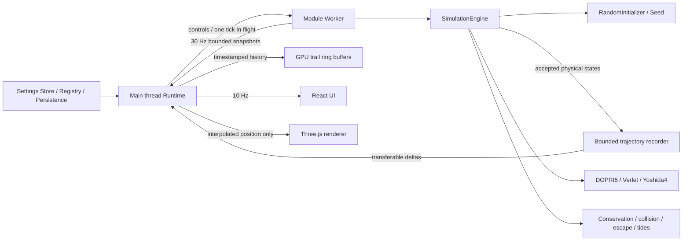

# V0.2.1 架构

`physics/` 与 `SimulationEngine` 仍为纯 TypeScript，Node 中可直接测试。`SimulationRuntime` 只用一个轻量引擎生成首次静态快照，生产 RAF 不调用其 advance；权威积分和真实积分轨迹采样在 Worker 中。同步适配器只能显式通过 `synchronous:true` 注入，供原有单元测试使用；浏览器不静默回退到阻塞 UI 的全量积分。

Worker 协议定义 init、reset、controls、tick、visibility 及 snapshot/error。主线程最多一条物理请求未确认，积压只保留0.25秒活跃时间；隐藏/宿主暂停丢弃积压。Worker 时间预算1–4ms、最多256次尝试，预算不降低数值精度；不是硬实时保证，一次完整积分尝试可以略微超时。

初始化和自动重启直接调用 RandomInitializer，不创建筛选任务、候选队列或定时器。质量参考值在重置时读取，自动重启沿用本轮参考值。StructuredChaos / ScreeningJob 只供离线历史实验，不被生产入口导入；模式描述标为未启用。

每个接受且通过守恒检查的真实状态进入 TrajectoryRecorder。按弦偏差、速度方向/大小变化与0.5T₀时间上限压缩近直线段，弯曲/近掠保留更密集的积分端点；不制造样条点，不修改积分步长。每次请求将本批最新端点一起发送，Float64 的 `[bodyIndex,time,x,y,z]` 通过 transferable buffer 转移，无需反复复制整段历史。Worker 固定4096点暂存，每次最多256步、4天体，正常最多约1032点；主线程立即写入每体8192点镜像环形缓冲。时间戳二分选择0.1–10模拟年的可见范围，GPU仅批量上传脏区间。四体历史CPU约1MiB、GPU位置约0.75MiB，加上约160KiB Worker暂存；持续运行不扩容。点数上限优先，极高采样密度下实际保留时间可能更短。generation切换同时清空Worker批次和GPU有效范围，旧Worker由epoch隔离。

普通重启复用 Engine 会话历史并生成新初始状态，不更换 Renderer 或 Worker。Worker 自身故障才终止并重建 Worker，最多30秒内两次自动恢复，第三次需手动解除；继续携带事件/次数，并用 epoch 忽略旧 Worker 回调。页面隐藏或暂停期间到期的恢复会等待重新激活。Renderer 只在图形错误重试时重建，轨迹按 generation 清空。

未改变的事件历史不重复跨线程复制，主线程保留上次列表；新事件/重置则发送完整的有界历史。UI快照与渲染最新快照分开，React约10Hz发布；渲染只做位置插值，不将插值反馈到物理，也不外推轨道。默认壁纸绘制30Hz，镜头交互期间60Hz，高负载时20Hz；没有位置、相机或反馈变化时跳过 GPU 绘制。像素比上限1.75、1800背景星、每体8192点轨迹上限、一个有限生命周期的潮汐反馈环。事件历史有界200条。

## 配置与扩展

- `AppSettings`、`SettingsRegistry`、`DefaultsProvider`、`SettingsPersistence` 分离；V0.1版本1存储格式兼容，新增质量、尾迹时间长度键取默认值，非法值逐项忽略。
- 三个质量控件为下一次初值参考值，不在积分中突然改变质量。逃逸策略与数值容差目前由代码定义，不提供无效高级控件。
- `FeatureRegistry` 的 register/enable/disable/dispose 与类型化 EventBus 保留。16类模块仍有明确配置边界：Quick、Physics、Initial、Camera、Orbit、Background、Dust、PostProcessing、Temperature、Civilization、Log/Ranking、Widgets、Audio、Notifications、Wallpaper、Loading。
- 已实现模块与未来契约见 UI 设置中的开发状态；文明/温度/音频分析/粒子/HDR仍未实现。默认音频窗口为静态占位，不申请设备权限。
- `WallpaperHostAdapter` 只映射外部属性并调用 Store / runtime.setHostPaused；桌面通知仍需独立 `NotificationHostAdapter`，不假设 Web wallpaper 有系统通知能力。
- 替换算法实现 `Integrator`（固定步）或自适应Stepper；`InitialConditionGenerator` 的 Random 可用，StructuredChaos 暂停启用，LongLived 等更强策略仍为未来入口。

## 复现

`benchmarks/baseline/` 是提交83acfeb的原始物理与引擎快照，不用于生产，不随V0.2重构改写。数值基准可离线执行；浏览器基准需要该提交的Git历史，从临时目录构建原版并在两个本地端口测量，结束后释放进程与临时文件。基准数据不是跨硬件性能保证。
