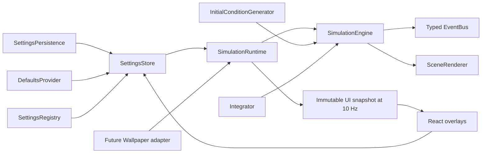

# 架构与扩展

## 数据流

`SimulationEngine.advance()` 只接受已激活的现实秒，不访问 DOM。它累积固定物理步、维护结束状态、重启冷却、Seed 链和事件。物理状态只有引擎和积分器可写，渲染器通过只读视图取位置，不修改任何天体。React 使用深拷贝后的天体快照，避免渲染中读到正在积分的数组。事件历史有界，快照控制状态单独复制。

`SimulationRuntime` 管理 RAF、可见性和设置订阅；UI 只在约 10 Hz 发布快照。每次重置递增 generation，渲染器清空轨迹。不会重新创建 WebGL Renderer；只有画面组件销毁或用户主动重试渲染才释放/重建。渲染器清理 OrbitControls、ResizeObserver、geometry、material、texture 和 canvas。轨迹每 0.025 T₀ 采样一次，最多 512 点，使用镜像环形缓冲而非无限增长数组。恒星背景只有 1800 点，像素比上限 1.75。

默认渲染当前固定步状态，尚未做帧间插值。轨迹在渲染帧采样，因此其采样密度不承担物理结果的复现保证；同 Seed、同累计固定步数才对应同物理状态。真实钟面是独立组件，使用系统 Date。

## 积分器和初始条件

- 新积分器实现 `Integrator` 的 `step(bodies, dt, config)`，在创建引擎时注入。Yoshida4 只是配置模式预留，不能在 UI 中选择。
- 新生成器实现 `InitialConditionGenerator`，在 `GENERATORS` 中登记实现情况；以后可增加预筛选候选初值、准稳定构型和配置参数。未实现模式不会退化为 Random 并伪装为长期稳定。
- 本阶段质量、引力、步长等固定配置仅在引擎构造时注入，不对用户开放高级控件。未来编辑时应校验并开启新一轮，以避免在步中改变哈密顿量。
- 碰撞/异常先终止物理推进；下一轮从新初值开始。自动 Seed 为 `hashSeed(currentSeed + ':next')`，整个自动序列可复现。

## 设置与模块

1. 当前设置在 `AppSettings` 中定义，在 `SettingsRegistry` 登记标签、类型、分类和运行时校验。
2. 默认值只来自 `DefaultsProvider`，持久化只负责 `load/save`，Store 负责从未知 JSON 中逐字段校验；不直接信任存储内容。保存封装含版本号；不支持的版本安全回落默认值。
3. 设置 UI 遍历 Registry 分类和字段，不需要为每个设置重建整个面板。V0.1 支持 boolean / number / seed 三种控件；未来新控件需增加相应 renderer 和 schema。
4. `FutureFeatureConfig` 覆盖 16 个扩展领域；它们不是已经启用的设置，不会写入当前持久化。实现新模块时再加入实际设置定义、默认值、校验和版本迁移。
5. `FeatureRegistry.register/enable/disable/dispose` 支持逐步注册和幂等启用，模块可在 activate 时订阅事件并返回 cleanup。V0.1 内建物理/渲染直接由应用组合根装配，模块目录用于开发状态和未来可选模块；未实现模块不能启用。
6. `EventBus<AppEvents>` 为 simulation / termination / visibility / notification 提供类型契约。UI 的事件列表是实际物理事件，不是文明日志。

## 宿主边界

未来 Wallpaper Engine 适配器负责外部属性名到 `AppSettings` 的映射、转换、校验和生命周期。调用 `SettingsStore.set` 更新已实现属性，调用 `SimulationRuntime.setHostPaused` 暂停宿主调度中的物理推进。默认浏览器路径不安装任何 WE 全局变量。

应用内通知来自事件总线。桌面通知必须另行实现 `NotificationHostAdapter`，显式报告 capability，并由真正具备该能力的宿主处理。音频来源同样由 `AudioSourceAdapter` 提供；V0.1 不申请任何设备权限。

## 边界

- 自动重启累计数在当前页面会话内保留，不跨页面持久化；所有结束/重置事件最多保留 60 条。
- 页面隐藏时暂停全部动画调度，返回时不追赶隐藏时间。暂停设置也冻结自动重启倒计时。
- 当前镜头跟随恒星质心，不自动强制拉远以容纳逃逸天体；用户可以滚轮缩放到更远处。
- 应用优先面向桌面；窄窗口双栏面板可各自滚动。设置面板作为浮层暂时覆盖右侧信息区域，主画面仍可见。
- WebGL 不可用时展示恢复提示，物理不会在无画面的后台持续消耗资源。
