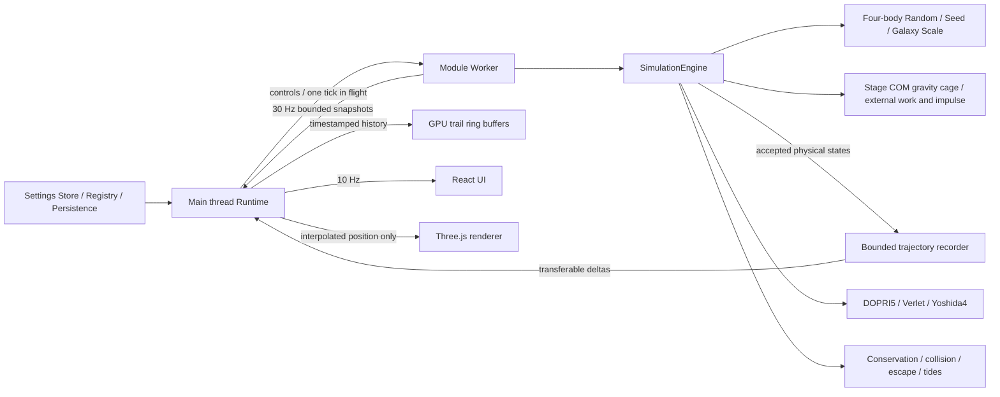

# V0.4 架构

`physics/` 与 `SimulationEngine` 仍为纯 TypeScript，Node 中可直接测试。`SimulationRuntime` 只用一个轻量引擎生成首次静态快照，生产 RAF 不调用其 advance；权威积分和真实积分轨迹采样在 Worker 中。同步适配器只能显式通过 `synchronous:true` 注入，供原有单元测试使用；浏览器不静默回退到阻塞 UI 的全量积分。

Worker 协议定义 init、reset、controls、tick、visibility 及 snapshot/error。主线程最多一条物理请求未确认，积压只保留0.25秒活跃时间；隐藏/宿主暂停丢弃积压。Worker 时间预算1–4ms、最多256次尝试，预算不降低数值精度；不是硬实时保证，一次完整积分尝试可以略微超时。

V0.3.1 的 tick 另带未截断 wallElapsed，用真实活跃时间计算近期实际倍速；目标可达100×，不改数值步长/容限。Seed 模式属于每场会话，自动重启额度在 Engine 与主线程故障恢复均执行；RunStatistics 与有界事件历史可随 Worker 恢复传递。referenceMasses/galaxyScale 初始化元数据区分本轮实际输入与 UI 待应用草稿，供当前 Seed 精确重跑。所有数值控件共用 NumericSetting 与 Store 步长校验。

初始化和自动重启直接调用四体 RandomInitializer，以有界代数拒绝采样约束初态，不创建预积分筛选任务、候选队列或定时器。质量参考值在重置时读取，自动重启沿用本轮参考值。StructuredChaos / ScreeningJob 只供离线历史实验，不被生产入口导入；模式描述标为未启用。

每个接受且通过守恒检查的真实状态进入 TrajectoryRecorder。按弦偏差、速度方向/大小变化与0.5T₀时间上限压缩近直线段，弯曲/近掠保留更密集的积分端点；不制造样条点，不修改积分步长。每次请求将本批最新端点一起发送，Float64 的 `[bodyIndex,time,x,y,z]` 通过 transferable buffer 转移，无需反复复制整段历史。Worker 固定4096点暂存，每次最多256步、4天体，正常最多约1032点；主线程立即写入每体8192点镜像环形缓冲。时间戳二分选择0.1–10模拟年的可见范围，GPU仅批量上传脏区间。四体历史CPU约1MiB、GPU位置约0.75MiB，加上约160KiB Worker暂存；持续运行不扩容。点数上限优先，极高采样密度下实际保留时间可能更短。generation切换同时清空Worker批次和GPU有效范围，旧Worker由epoch隔离。

普通重启复用 Engine 会话历史并生成新初始状态，不更换 Renderer 或 Worker。Worker 自身故障才终止并重建 Worker，最多30秒内两次自动恢复，第三次需手动解除；继续携带事件/次数，并用 epoch 忽略旧 Worker 回调。页面隐藏或暂停期间到期的恢复会等待重新激活。Renderer 只在图形错误重试时重建，轨迹按 generation 清空。

未改变的事件历史不重复跨线程复制，主线程保留上次列表；新事件/重置则发送完整的有界历史。UI快照与渲染最新快照分开，React约10Hz发布；渲染只做位置插值，不将插值反馈到物理，也不外推轨道。默认壁纸绘制30Hz，镜头交互期间60Hz，高负载时20Hz；没有位置、相机或反馈变化时跳过 GPU 绘制。像素比上限1.75、1800背景星、每体8192点轨迹上限、一个有限生命周期的潮汐反馈环。事件历史有界200条。

## 配置与扩展

- `AppSettings`、`SettingsRegistry`、`DefaultsProvider`、`SettingsPersistence` 分离；V0.1版本1存储格式兼容，新增质量、尾迹时间长度键取默认值，非法值逐项忽略。
- 三个质量控件为下一次初值参考值，不在积分中突然改变质量。逃逸策略与数值容差目前由代码定义，不提供无效高级控件。
- `FeatureRegistry` 的 register/enable/disable/dispose 与类型化 EventBus 保留。16类模块仍有明确配置边界：Quick、Physics、Initial、Camera、Orbit、Background、Dust、PostProcessing、Temperature、Civilization、Log/Ranking、Widgets、Audio、Notifications、Wallpaper、Loading。
- 已实现模块与未来契约见 UI 设置中的开发状态；文明/温度/音频分析/粒子/HDR仍未实现。默认音频窗口为静态占位，不申请设备权限。
- `WallpaperHostAdapter` 只映射外部属性并调用 Store / runtime.setHostPaused；桌面通知仍需独立 `NotificationHostAdapter`，不假设 Web wallpaper 有系统通知能力。
- 替换算法实现 `Integrator`（固定步）或自适应Stepper；`InitialConditionGenerator` 的 Random 可用，StructuredChaos 暂停启用，LongLived 等更强策略仍为未来入口。

## 复现

`benchmarks/baseline/` 是提交83acfeb的原始物理与引擎快照，不用于生产，不随V0.2重构改写。数值基准可离线执行；浏览器基准需要该提交的Git历史，从临时目录构建原版并在两个本地端口测量，结束后释放进程与临时文件。基准数据不是跨硬件性能保证。

## V0.3 尺度与牢笼

SettingsRegistry定义Galaxy Scale和原版确认的9个牢笼控件，沿用现有设置持久化及分类布局。Runtime仅在配置改变时发送configure；Worker保存待生效尺度，下一轮生成时应用。牢笼通过Engine.setCage热更新并重建诊断基准，不清空轨道或重建Renderer。

DOPRI5每个阶段用阶段状态计算全四体COM，叠加独立牢笼力。开启时追加4维状态（外力做功和三维冲量），使用同一嵌入误差控制；关闭后移除这4维及额外力。角动量使用COM系。弦检查回退与辅助状态一起回滚；宏步末尾极小补齐步不会污染下一宏步的建议步长。完整公式、来源、边界差异及测试见[V0.3说明](v0.3.md)。尾迹Recorder、Trail和CSS布局未修改；Renderer只为尺度增加相机距离/远裁面适配。

## V0.4 环境与文明

`OriginalRandomInitializer` 为生产初值提供器；旧 `RandomInitializer` 供历史基准。初值设置与运行设置分离：Worker 保存生成本轮的实际输入，修改后在下一轮采用，当前 Seed 重跑恢复该输入。

`SimulationEngine.environment` 管理独立的 `CivilizationSimulation`，只读取接受且通过守恒检查的物理状态，不写位置、速度或重启控制。`temperature.ts` 计算物理读数，`eras.ts` 管理判定与确认，文明类管理虚拟计数、生命周期和有界历史。`end` 直接通知文明，避免原版共享 rst 信号竞争；`start` 先结束旧宇宙再创建第零年的新环境。新 Worker 的历史会话交接与已有活跃宇宙的重置分开处理。

物理年 = T₀/2π；虚拟文明回调 60 次/物理年；文明年增量 = 物理年增量×(Kt/10)²。温度正弦相位也取物理时间，不使用 React 或墙钟。临界灾难每个接受步检查，不等待下一虚拟回调或信息面板刷新。

Worker 每次只传有界当前读数；环境历史 revision 未变化时省略重复数组，Runtime 恢复前次数组。原有轨迹传输与渲染缓冲未修改。会话榜仅六条，通过 Worker 故障恢复交接；故障在最后确认状态结束文明，不伪造未收到的时间。全部新增设置由 `V04_RULES` 统一定义类型、默认值、范围和描述，沿用持久化 schema v1。设置分类折叠时不挂载内部控件。

完整映射、平台适配及原版缺陷修复见 [V0.4机制文档](civilization-v0.4.md) 与 [功能覆盖清单](civilization-v0.4-coverage.md)。
