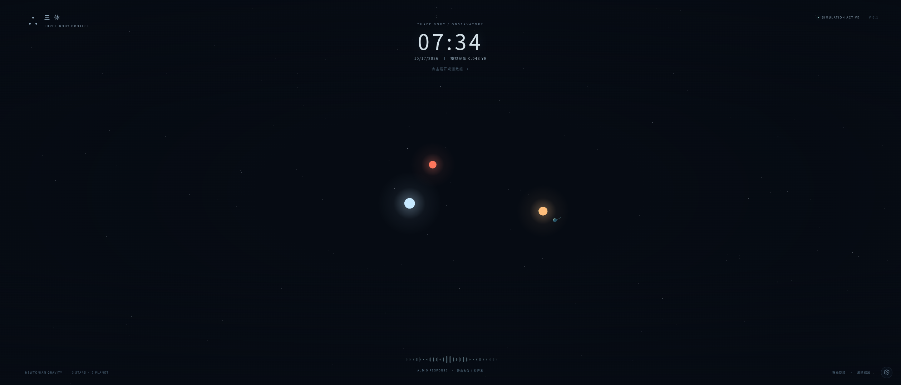
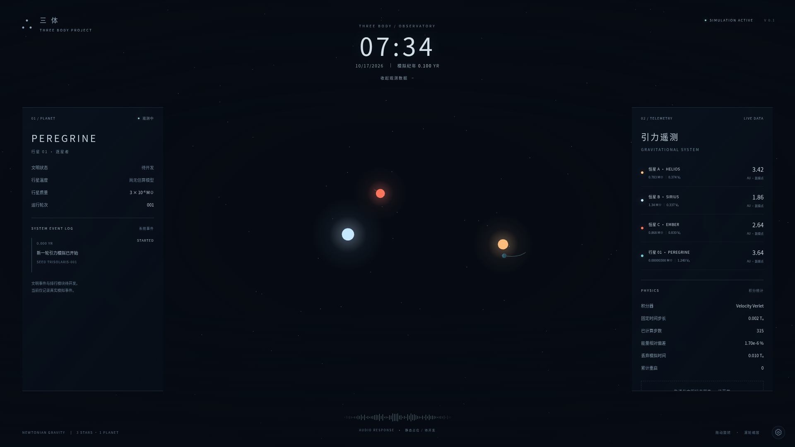

# V0.1 验证记录

验证环境：Linux 云环境，Node.js 24.19.0，系统 Chromium（通过 Playwright，以 SwiftShader 软件 WebGL 执行）。并未在 Windows/macOS 实机 GPU 上做兼容性验收；应用使用标准浏览器 API，不含平台专用运行依赖。

## 自动化

- `npm ci`：依赖可从锁文件安装。
- `npm test`：28 项通过，覆盖物理、生命周期、设置、React 交互、可见性调度和有界资源。
- `npm run typecheck`：strict TypeScript 检查通过。
- `npm run build`：Vite 生产构建成功。
- `CHROMIUM_PATH=/usr/bin/chromium npm run test:e2e`：4 项通过，2 项有意跳过（WebGL 失败路径仅在 desktop 项目执行一次）。

物理测试检查逆平方力、动量、双体圆轨道 20 个周期、能量偏差、二阶收敛、时间反演、重合位置保护、200 个 Seed 的初值有效性和多条件逃逸。生命周期覆盖 30/144 FPS 同结果、暂停恢复、步数上限、碰撞重启、关闭自动重启、Seed 链、积分异常、持续逃逸和频繁失败熔断。

长时推进测试覆盖 12 个 Seed，每个执行 1200 次 0.1 秒活跃时间输入，10× 加速；包括自然结束/自动换轮。检查所有数值保持有限、事件上限；这不等于对任意初值永远稳定的证明。轨迹单独检查 2000 次追加后仍只有 512 个显示点、固定内存、正确的环形顺序与重置清空。

浏览器测试验证：

- 2520×1080、1920×1080、640×800 全屏画面及信息面板在视口内，左右面板互不重叠。
- WebGL 实际绘制、模拟时间推进、暂停后纪年不变、速度/轨迹/自动重启控件、应用 Seed、手动重置。
- 重置前后是同一个 canvas DOM 节点。
- Escape 关闭设置、镜头拖动/滚轮、缩放到 960×540 后无页面滚动溢出或 JavaScript 错误。
- WebGL 不可用时显示中文恢复提示和重试按钮。

浏览器场景每次均使用独立存储上下文。默认截图拍摄于一轮开始后不久，因此轨迹较短。设置浮层打开时允许覆盖右侧遥测区域，场景中心仍保留可视空间。

## GitHub Pages 配置验证

- 添加仅 `main` 推送或手动触发的 Pages 工作流，测试及构建成功后上传 `dist/`，使用官方 Actions 部署到 `github-pages` 环境。
- 默认 `npm run build` 仍使用 `./`，构建成功；`VITE_BASE_PATH=/1/ npm run build` 也成功。
- 检查 Pages 产物中的入口 JavaScript、Three.js 分包和 CSS 均指向 `/1/assets/`，并对应存在的静态文件。
- 在 `/1/` 生产预览地址执行完整浏览器套件：4 项通过，2 项为重复失败路径的有意跳过。额外断言脚本/样式响应成功且资源 URL 位于正确的子路径，交互和 WebGL 同原版。
- 重新运行 28 项测试、strict 类型检查、格式检查和差异检查，均通过。`src/` 中的物理模拟、渲染和 UI 源文件没有改动。

当前变更提交在 PR #1；尚未合并 `main`，因此没有触发真实 Pages 发布。仓库管理员需在 Settings → Pages 选择 GitHub Actions，并满足私有仓库的 Pages 套餐要求；合并后的线上部署以 Actions 结果为准。网页端步骤见 README。

## 截图

21:9 默认状态，信息面板隐藏：

16:9 展开左右信息面板：

