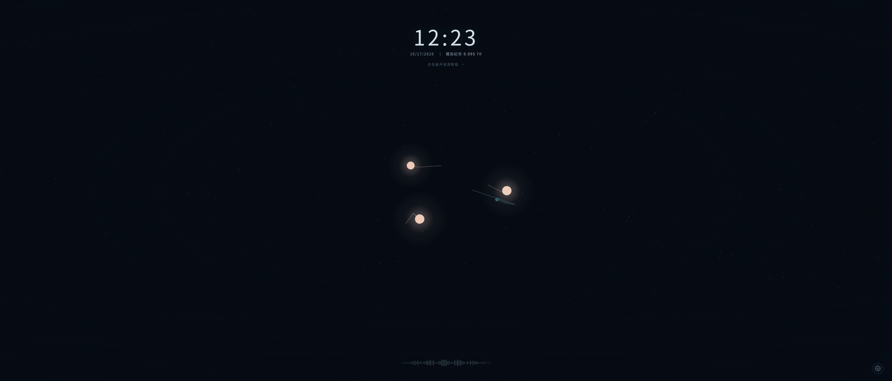
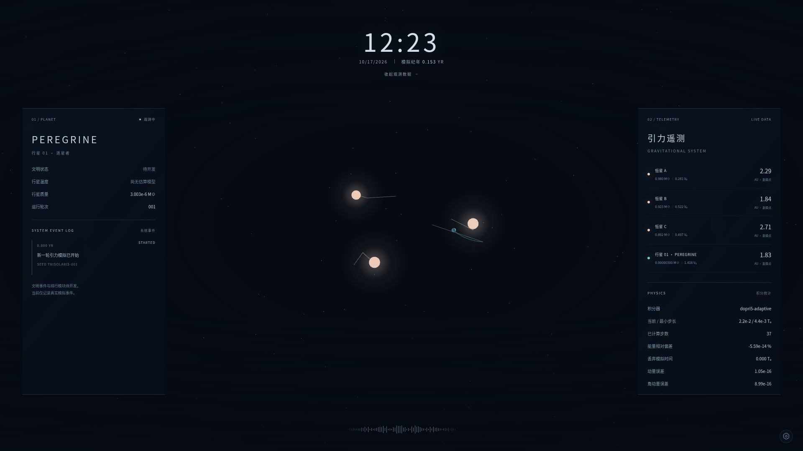

# V0.2 验证记录

Linux 云环境，Node 24.19.0，Chromium / SwiftShader 软件 WebGL。未做 Windows/macOS 实机 GPU 验收，未把本次 PR 部署到生产。

- `npm test`：48 项；保留 V0.1 28项基础覆盖，补充自适应、潮汐、筛选和 Worker 测试。
- `npm run typecheck`：strict TypeScript，包含生产代码、基准代码、冻结基线、单元及浏览器测试。
- 默认 `npm run build` 与 `VITE_BASE_PATH=/1/ npm run build`：生成可运行静态产物及独立 module Worker。
- `/1/` 生产预览浏览器套件：4项实际执行，2项为重复 WebGL 失败路径的有意跳过；覆盖2520×1080、1920×1080、640×800，以及运行中960×540缩放。
- 浏览器确认：物理 Worker 正常加载，多次重置保持同一 Worker 和 canvas；暂停时间冻结、Seed重置、设置、信息面板、拖动缩放、子路径 JS/CSS/Worker响应正常；无页面错误。
- `npm run benchmark`：24 Seed × 20年三组种群，以及同初值的7种积分配置；内核预热后3次计时。
- `CHROMIUM_PATH=/usr/bin/chromium npm run benchmark:browser`：原版/新版、1×/20×、三轮交替、每次6秒；原始12组样本保留。
- `npm run format:check` 与 `git diff --check`：代码与格式检查。

测试验证自适应拒步不修改状态、距离/速度/质量影响步长、偏心近掠与假碰撞保护、Yoshida精度、张量本征值/旋转/叠加/抵消、Roche密度与强度缩放、尖峰抑制、潮汐事件归因及重启、近抛物线逃逸余量、筛选分片复现与有限降级、Worker背压/隐藏冻结/撤销旧任务/失败历史与熔断、质量设置兼容。

数值基线源码从83acfeb冻结，并逐字节核对原提交。详细数据、局限与未改进指标见 [基准报告](benchmarks/README.md)；参数来源与公式见 [物理研究](physics-v0.2.md)。图像为实际运行截图，物理真实半径与显示半径分开。

## 21:9 默认状态

## 16:9 信息面板

